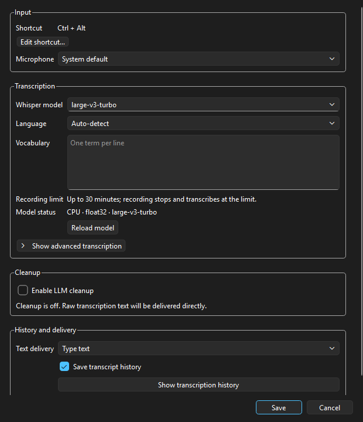
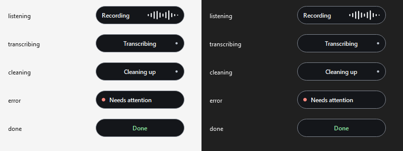

# Orpheus

Local voice dictation for Windows. Press a global shortcut, speak, then press it again to transcribe and insert text into the original application. Whisper runs on your CPU or an optional NVIDIA GPU. Optional cleanup uses Ollama, locally by default.

## Daily use

- The default shortcut is `Ctrl+Alt+Space`; existing custom shortcuts, including modifier-only `Ctrl+Alt`, are preserved.
- Press once to record and again to stop. During transcription or cleanup, the shortcut cancels that session.
- Recordings retain their beginning and stop automatically at **30 minutes**, then transcribe the complete captured audio. No rolling five-minute overwrite.
- Successful CPU startup is silent. The tray and Settings show model readiness and the active backend/precision.
- Right-click the tray icon for **Settings**, **Transcription history**, **Recover text / errors**, and **Quit**.





The captures above use synthetic data and native Windows widgets.

## Recovery and delivery

A completed transcript is saved to history before automatic insertion when history is enabled. A failed insertion, changed destination, or history-write failure leaves a recovery copy available from the tray. Cleanup failures fall back to the raw transcript.

Recovery offers explicit copy, dismiss, and retry actions. Retry is armed first: focus the intended text field and press the dictation shortcut to confirm insertion. If insertion was partial, review the destination before retrying to avoid duplicates. Unsaved recovery copies require acknowledgement before dismissal; quitting with unfinished or unsaved work asks for confirmation.

With history disabled, recovery copies exist **only in memory until Orpheus exits**. Audio is not saved to disk. Model failures cannot reconstruct speech that was never successfully transcribed. Explicit cancellation before delivery discards that session; cancellation after partial insertion keeps a recovery copy. Already inserted text is not automatically removed.

The intended top-level window and owning process are captured when recording starts and checked before delivery and between type-out chunks. If the target changes, automatic insertion stops. This does not identify individual fields inside one window, and checking focus plus sending input is not an atomic Windows operation.

Type-out handles Unicode, Hebrew, emoji, and newlines. Paste mode supports **plain-text clipboard contents**; it refuses to replace images or rich clipboard formats. It restores prior text only if the clipboard sequence still belongs to the operation. A narrow race between sequence checking and restoration remains. Elevated applications may reject either delivery method; use recovery copy/paste when necessary.

## Settings and history

Settings groups Input, Transcription, Cleanup, and History/Delivery in a scrollable native form with fixed Save/Cancel buttons. Advanced transcription controls are collapsed by default. Vocabulary applies to Whisper even when cleanup is off. Settings preserves explicit CPU/CUDA choices and unedited options, validates values, and reports save failures without closing the dialog.

Changes that replace resources currently in use wait until the active work finishes. A rejected deferred shortcut change restores the active configuration. If a global hotkey cannot start, the tray remains available so Settings can repair it.

History supports search over raw and final text, pages beyond the latest 200 entries, raw/final comparison, word counts, selected-transcript UTF-8 export, and explicitly reviewed deletion of older entries. **Processing time** describes transcription/cleanup work, not the length of the spoken recording. Entries are kept by default; upgrading does not automatically delete history.

## Setup

Windows and Python **3.12** are required by this project's dependency range. The current environment uses PySide6 6.12.0, faster-whisper 1.2.1, and CTranslate2 4.8.3.

```powershell
py -V:3.12 -m venv .venv
.\.venv\Scripts\python.exe -m pip install -e ".[dev]"
.\.venv\Scripts\python.exe -m orpheus
```

The first model load may download weights to the Hugging Face cache. Later transcription runs locally. CPU is supported on AMD machines; NVIDIA CUDA is optional. Existing model, precision, and thread settings are retained. All logical threads are the current Auto behavior, not a measured claim that this is fastest.

For optional cleanup, run Ollama locally and install the selected model, for example `ollama pull llama3.1:8b`. Cleanup is configurable: choosing a remote Ollama URL sends transcript text to that endpoint. Keep a local URL when local-only processing is intended.

## Startup and local data

The existing Startup-folder installation is a shortcut to this checkout's `.venv\Scripts\pythonw.exe -m orpheus`. It is not a bundled Orpheus EXE. Source changes take effect on the next launch. See [deployment instructions](deploy/README.md) for the existing shortcut and Task Scheduler scripts; review their environment-path settings before running them.

Data under `%APPDATA%\Orpheus`:

| File | Contents |
| --- | --- |
| `config.toml` | Validated settings; saves use atomic file replacement. |
| `history.sqlite3` | Local plaintext raw/final transcripts when history is enabled. |
| `orpheus.log`, `.1`–`.3` | Up to four 1 MiB diagnostic files containing allowlisted event categories and scalar timing/backend fields. No transcript, audio, prompt, vocabulary, or arbitrary exception text is written to these logs. |

An invalid config is preserved until explicitly repaired and saved. Its repair form starts with history and cleanup disabled and does not activate a hotkey before repair. Turning history off stops new entries; it does not erase existing entries.

Important configuration values:

| Field | Default | Values |
| --- | --- | --- |
| `device` | `auto` | `auto`, `cpu`, `cuda`; explicit CUDA errors remain visible. |
| `model_size` | `large-v3-turbo` | Supported model alias, custom model ID, or local path. |
| `compute_type` | `float16` | Backend-supported precision; CPU falls back to int8 if needed. |
| `cpu_threads` | `0` | 0 means all logical CPUs; 1–128 is explicit. |
| `num_workers` | `1` | 1–16; pipeline scheduling remains bounded. |
| `max_recording_seconds` | `1800` | 60–1800; stop and transcribe at the limit. |
| `language` | `auto` | `auto`, `en`, `he`. |
| `cleanup_enabled` | `true` | Existing saved choice is preserved. |
| `delivery` | `type` | `type` or guarded plain-text `paste`. |
| `history_enabled` | `true` | Existing saved choice is preserved. |

## Implementation and validation

A single Qt process owns the tray, settings, history, and overlay. PortAudio captures audio. QThread jobs perform model loading and transcription/cleanup/delivery. Each session has its own identity, cancellation token, settings snapshot, and target. Obsolete results cannot reset a newer recording. There is one active transcription pipeline plus at most one pending current session; model construction is synchronized. Finished jobs release their captured resources and are deleted through Qt's lifecycle.

Quit cancels pending delivery and keeps the event loop responsive until uninterruptible backend work finishes. It then closes clients/history and exits. It never forcibly terminates a running QThread.

```powershell
.\.venv\Scripts\python.exe -m pytest -q
git diff --check
```

Automated tests use temporary data, fake audio/models/input APIs, finite Qt event-loop checks, and offscreen UI. They cover failure recovery, worker lifetime, cancellation, capture limits, configuration, history, accessibility metadata, and startup wiring. Real microphone accuracy, screen-reader operation, elevated windows, and actual insertion/focus behavior require the [relaunch checklist](docs/reviews/2026-10-23/IMPLEMENTATION.md).

CPU tuning has a [local-only benchmark harness](docs/benchmarks/README.md). No CPU tuning defaults have been changed, and no recognition-quality or speed improvement is claimed without measurements on representative English/Hebrew audio.
